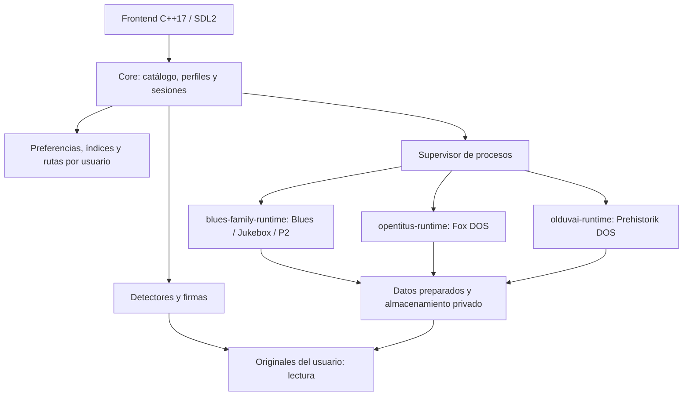
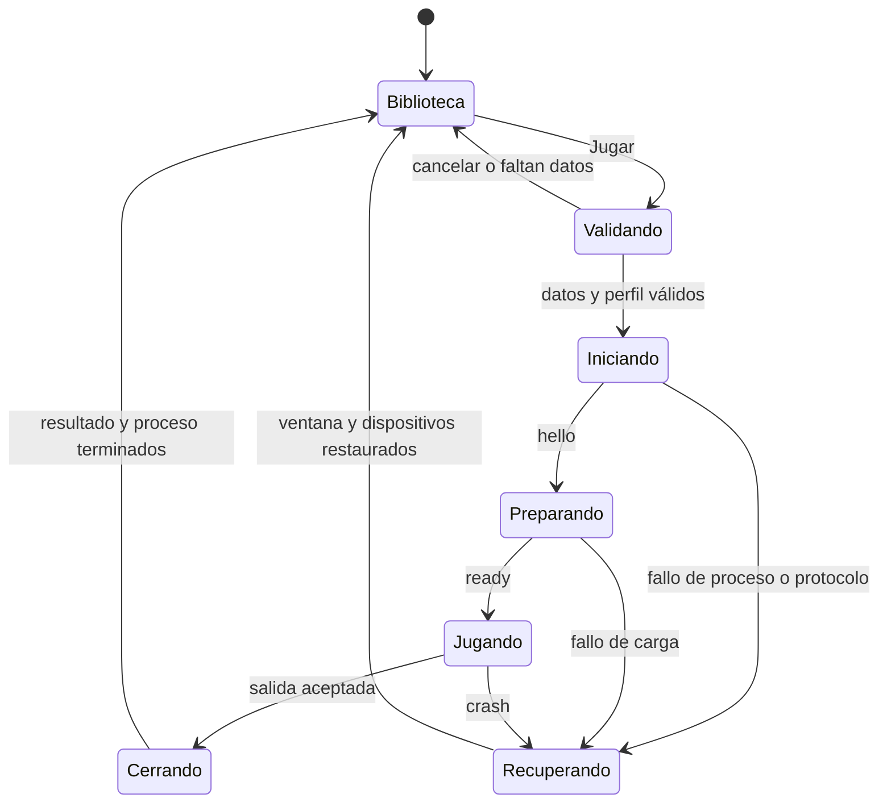

# TH-03: arquitectura y transición de Titus Engine

Decisión: **23 de noviembre de 2026**. **TH-03 completada como definición**.
Se apoya en [TH-01](ENGINE_AUDIT.md), [TH-02](ENGINE_REFERENCE_TESTS.md) y las
[reglas de identificación](GAME_DETECTION_RULES.md).

Esta entrega define contratos comprobables y el orden de implementación.
**No implementa aún el lanzador, catálogo persistente, adaptadores de sesión ni
migración de partidas**. Los ejemplos de `contracts/examples/` son datos de diseño,
no instalaciones registradas o ejecutables ya disponibles.

## Decisiones principales

| Área | Decisión |
|---|---|
| Primera integración | Lanzador y motores en procesos separados; una sesión de juego activa por instancia. |
| Frontend/core | C++17; core sin SDL, frontend SDL2. SDL_ttf 2.x para texto de biblioteca incorporado en TH-05, sin modificar HUD/fuentes de los juegos. |
| Motores | Conservar C en Blues/Jukebox/P2 y OpenTitus, C++17 en Olduvai; puente C/C++ pequeño por runtime. No convertir física o recursos al core común. |
| JSON | UTF-8, esquema v1. Parser: nlohmann/json 3.11.3, incorporado con su licencia en TH-04. Validación estricta de tipos, duplicados, límites y referencias. |
| IPC | Request JSON, eventos/comandos JSONL en directorio privado de sesión, resultado JSON atómico. stdout/stderr son logs, nunca el protocolo. |
| Progreso | Perfil estable por jugador/juego/grupo de compatibilidad, independiente de la ruta de instalación y de la edición de presentación cuando el motor lo permita. |
| Originales | Solo lectura. Preparación nativa y recursos privados para cada runtime; nunca arrancar EXE/COM del juego como programa del sistema. |
| Nombres | Producto/binario del frontend `Titus Engine` / `titus-engine[.exe]`. Conservar de momento remoto/directorio `blues-engine` y CLI `blues[.exe]`. |
| Integración en proceso | Fuera de esta primera implementación; evaluar en TH-11 con datos de estabilidad/licencias, sin condicionar TH-04. |

No se fija una fecha de entrega. TH-03 cierra estas decisiones; TH-04 comienza la
implementación del core del catálogo.

## Componentes y propiedad de recursos



El core no inicializa SDL ni incluye `intern.h`/`sys.h` de los motores. Gestiona
identidad, firmas, configuración, almacenamiento, capacidades y estado de sesión.
El frontend mantiene su ventana, navegación, texto, audio de menú y mando.
Cada runtime posee su propia instancia SDL, ventana, audio, entrada, variables
globales, relojes y recursos. No se envían frames, PCM, punteros ni estados
internos del juego por IPC.

Cada runtime arranca **un** juego y termina después de la sesión. Aunque el
binario Blues contenga tres módulos, nunca reutiliza el proceso para otro título.
Esto evita depender hoy de resets completos de globals, pools o bibliotecas
antiguas. Los namespaces COFF de TH-02 se conservan.

El binario del lanzador no enlaza los motores externos. Los puentes de OpenTitus
y Olduvai se compilan dentro de sus respectivos runtimes, con las licencias y
avisos correspondientes. La separación no resuelve por sí sola los derechos del
código heredado de cyxx/blues: siguen registrados en [CREDITS.md](../CREDITS.md).
No se asigna una nueva licencia general al repositorio ni se promete un paquete
distribuible antes de la tarea 18.

## Organización objetivo

```text
launcher/                 # app, biblioteca y navegación SDL2 (TH-05)
core/                     # catálogo, detección, perfiles y supervisor C++17
platform/                 # procesos/rutas/locks Windows y POSIX
adapters/
  blues/                  # selección explícita de game_t y puente C/C++
  opentitus/              # preparador, configuración y puente de Fox
  olduvai/                # preparador DIET y puente de Prehistorik
contracts/                # esquema, ejemplos y documentos del protocolo v1
bb/, ja/, p2/             # permanecen en su ubicación durante esta etapa
patches/                  # cambios identificables sobre revisiones externas
third_party/              # código incluido con revisión, licencia y cambios
tools/, tests/            # utilidades y comprobaciones de desarrollo
```

Estos directorios de implementación se crearán cuando empiece su tarea, no como
stubs que aparenten funcionalidad. TH-04 incorpora CMake para `titus_core`,
`titus-catalog` y sus pruebas; TH-05 incorpora `titus-engine`. Se conservan Makefile/Makefile.win para
el ejecutable clásico y las regresiones. Los motores externos tendrán builds
separados y reproducibles; el build común no descargará juegos o componentes al
iniciar una partida.

Dependencias del frontend: C++17, SDL2 ≥2.30.0 de la rama 2, parser JSON aislado
y texto SDL_ttf 2.x con DejaVu Sans y su licencia explícita desde TH-05. No se
introducen libmodplug/SDL 1.2/OPL en el core. La referencia Windows usa SDL2
2.30.11; OpenTitus mantendrá su SDK SDL 1.2 compatible y SDL_mixer en su carpeta.
El parser elegido tiene una
[revisión fijada y checksum del header publicados](https://github.com/nlohmann/json/releases/tag/v3.11.3):
`json.hpp` SHA-256 `9bea4c8066ef4a1c206b2be5a36302f8926f7fdc6087af5d20b417d0cf103ea6`.
El header se incorpora desde TH-04; no se afirma usar la última versión.

Paquete objetivo (no construido por TH-03):

```text
titus-engine.exe
SDL2.dll                   # frontend
engines/
  blues-family/blues-family-runtime.exe   # su SDL2.dll y dependencias
  opentitus/opentitus-runtime.exe         # SDL.dll, SDL_mixer.dll, SDL2.dll
  olduvai/olduvai-runtime.exe             # dependencias/avisos de su build
```

Linux conserva la misma organización sin `.exe`. Cada runtime se resuelve
desde la ruta absoluta de instalación del producto y un registro del paquete;
no desde PATH, CWD o datos del usuario. Las carpetas de DLL evitan mezclar
versiones incompatibles. El registro de ejemplos tiene `role=design` y
`adapter_state=planned`; para habilitar Jugar harán falta registro de paquete,
adaptador instalado/validado y datos compatibles.

## Catálogo e identidad

El catálogo contiene UUID de perfil e instalación, juego, edición, variante,
motor candidato, grupo de compatibilidad de partidas, fingerprint y ubicaciones.
Una ubicación tiene plataforma, ruta absoluta UTF-8 y tipo directorio/ADF.
No contiene una orden de shell, ruta de ejecutable o variables de entorno.

Los identificadores iniciales son `blues`, `jukebox`, `prehistorik2`, `fox` y
`prehistorik`; los motores `blues-family`, `opentitus` y `olduvai`. Blues admite
DOS/Amiga; los demás runtimes iniciales solo DOS. Los conjuntos Fox/Prehistorik
Amiga se pueden identificar como `missing_engine`, sin botón Jugar ni motor DOS
asignado. Los ADF se registran como fuentes; **v1 no arranca imágenes directamente**.

El fingerprint de una instalación será SHA-256 de un manifiesto canónico de
recursos requeridos: nombre relativo ASCII normalizado/minúsculas, tamaño y
SHA-256 de contenido, ordenados por nombre y serializados en UTF-8 con separadores
JSON canónicos. Sin rutas absolutas, fechas, `:Zone.Identifier` o archivos de
documentación. TH-04 fija los manifiestos completos por perfil en `core/data_profiles.json`
a partir del inventario; un marcador aislado no valida toda la instalación.

Serialización exacta v1: objeto con `version=1`, `game_id`, `edition_id`,
`variant_id` y `files`. Cada entrada de files contiene solo `name`, `size` y
`sha256`; ordenar files por name y claves de todos los objetos alfabéticamente,
sin espacios, BOM ni salto de línea final. Nombres relativos con `/`, sin `.`/`..`,
en minúsculas ASCII; tamaños enteros no negativos ≤2^53−1 y hashes hex minúsculos.
Duplicados de nombre normalizado con contenido distinto son ambiguos; duplicados
idénticos se reducen a una entrada. [Vector v1](../contracts/fingerprint-v1-vector.json)
fija bytes/hash para las pruebas C++ futuras; contiene **un manifiesto parcial**,
no un perfil completo con el que admitir una instalación.

Mover una carpeta cambia su ubicación, no UUID o progreso, si el manifiesto
coincide. La misma carpeta puede producir dos instalaciones lógicas: Prehistorik
2 y Prehistorik 1 DIET. Copias idénticas pueden añadirse como ubicaciones
alternativas del perfil reconocido, conservando la elección del usuario.
Eliminar del catálogo quita referencias; nunca originales, cachés ajenas o saves.
Una extracción y su ADF se relacionan para evitar duplicar un mismo conjunto.

## Contrato de los adaptadores

Interfaz interna objetivo; **no es un ABI de plugins cargables**:

| Operación | Entrada → salida | Implementación |
|---|---|---|
| `inspect` | Instalaciones/manifiestos → variante, recursos faltantes, capacidades y preparaciones necesarias | Sin SDL; nunca deducir compatibilidad por salir con código 0. |
| `prepare` | Fuentes verificadas y workspace → recursos privados y manifiesto de salida | Cancelable; validación de hash/tamaño; no ejecutar el EXE/COM original. |
| `start` | LaunchRequest v1 → identificador de proceso y canales | Rutas/argv Unicode del sistema; selección explícita de juego. |
| `request_return` | Sesión → petición de vuelta | Confirmación nativa si hay progreso sin guardar; nunca convertirlo en kill automático. |
| `pause` / `resume` | Sesión → aplicado o `unsupported` | Solo con `remote_pause`. La pausa nativa no implica soporte remoto. |
| `collect_result` | Proceso terminado + eventos + resultado → cierre válido/error/cancelación | Contrastar protocolo y salida real del SO. |
| `inspect_saves` | Perfil y compatibilidad → slots/metadatos | Solo cuando exista adaptador; no interpretar todos los formatos como BBS. |

Para consultar capacidades/partidas sin enlazar código del juego en el frontend,
el runtime tendrá `--inspect-request RUTA`: un proceso corto, sin inicializar
SDL/audio, que responde atómicamente con `inspection.json`. Usa `inspection_id`
propio, identidad del perfil/juego/grupo y los mismos límites/rutas de fuentes.
El resultado declara `ok`, `preparation_required` con preparadores concretos, o
`failed`; nunca se toma como una sesión de juego ready. Puede devolver índice
nativo de slots, o null si no puede inspeccionarlos aún. No modifica originales,
opciones o saves ni ejecuta preparaciones durante la consulta. Una preparación
pendiente se realizará antes de jugar y la inspección podrá repetirse después.
El frontend no decodifica el estado interno del juego. La consulta se hace con
el perfil libre, y se invalida si cambia el manifiesto de los recursos.

El runtime Blues seleccionará `game_bb`, `game_ja` o `game_p2` por el `game_id`
validado, no por el primer archivo encontrado. Su entrada gestionada tendrá un
puente C que inicializa opciones y llama al módulo; la CLI clásica sigue aparte.
Fox y Olduvai se enlazarán con su propio bootstrap/puente. No se reutiliza como
runtime el script Python ni se deja un host permanente que finja carga correcta
por haber arrancado un ejecutable antiguo.

Preparadores de producto: C/C++ nativos, limitados a las variantes verificadas y
contrastados con los hashes de TH-02. Deark/Unicorn/Python son herramientas de
desarrollo, no requisitos que instalará el jugador. TH-08 implementa la vía
nativa LZW para Fox; TH-09 implementa DIET para Prehistorik 1. Solo se habilitan
adaptadores cuya preparación y ejecución estén validadas.

## Capacidades y opciones

Las capacidades del registro son referencia, no permiso para dibujar controles
activos. `inspect` las resuelve para los datos reales; el request declara las que
necesita y `ready` confirma las efectivas. Si falta una requerida, fallar antes de
la partida con `E_UNSUPPORTED_SETTING`; no ignorar opciones silenciosamente.

- Blues conserva ocho slots, miniaturas, rebobinado, zoom, cámaras/HUD originales
  y suavizados, ayudas, vidas, selector de nivel/personaje, volúmenes y F6.
- F6 necesita ambas ediciones compatibles; Concierto Amiga conserva su dependencia
  DOS cuando corresponda. Un segundo datapath de otro juego no satisface F6.
- Jukebox/P2/Fox/Prehistorik no heredan trucos, HUD, rebobinado o guardados de Blues.
  Sus capacidades se activarán únicamente al implementar/probar sus adaptadores.
- `native_pause` es la pausa del juego; `remote_pause` permite además comandos del
  lanzador. No se anuncia este último por defecto en ningún ejemplo de referencia.
- Cargar slot desde la biblioteca es inicialmente Blues-only. Los menús propios
  de otros motores pueden mantener funciones nativas aún no integradas globalmente.

Reconocer una instalación no garantiza cumplir dependencias de otra edición:
`inspect` resuelve, por ejemplo, el complemento DOS de Concierto Amiga con las
fuentes seleccionadas. No marcar una fuente Amiga como desconocida ni cambiar su
fingerprint por añadir ese complemento; fallar la inspección de la combinación
incompleta con `E_DATA_MISSING` antes de habilitar Jugar.

Resolución de ajustes: defaults del motor → defaults globales **soportados** →
ajustes del perfil/juego/grupo → overrides de edición → cambios de esa sesión.
Al cargar, el payload nativo gobierna el progreso y el estado capturado; no se
reescribe para imponer nuevos defaults. Los overrides de sesión no se guardan automáticamente. Cada clave tendrá un solo
propietario persistente. Los ajustes editados en menú nativo se recogen mediante
el adaptador después del cierre y se traducen a las claves comunes, sin dos
escritores simultáneos sobre INI/JSON.

## Protocolo de sesión v1

La invocación de cada runtime gestionado será `--session-request RUTA_REQUEST`.
El launcher crea `request.json`, `events.jsonl`, `commands.jsonl` y reserva
`result.json` dentro de un directorio de sesión con UUID nuevo. La ruta se pasa
como argumento del sistema, nunca concatenada a shell/cmd/batch. La utilidad
WSL de TH-02 no se convierte en mecanismo de arranque del producto.

La consulta `--inspect-request` es un job distinto, con UUID/directorio nuevo,
request de inspección y `inspection.json`; no usa la secuencia hello/ready/closing.
Una consulta de más de 30 s muestra estado de falta de respuesta. Solo es válida
si la identidad coincide y el proceso termina con código 0; un resultado failed
con código 0 sigue siendo fallo. Sus capacidades sirven para componer el launch,
que vuelve a verificarlas y a cargar recursos de forma independiente.

Request inmutable: perfil, instalación primaria, juego/motor/edición explícitos,
fuentes de solo lectura, fingerprint, storage, acción nueva/cargar slot, ajustes,
capacidades requeridas y permiso explícito de jugar sin audio (false por defecto).
Todo se valida otra vez en el bootstrap. No admitir nombres de ejecutables en él.

Los JSON usan [JSON Schema 2020-12](https://json-schema.org/draft/2020-12/json-schema-core),
UTF-8 sin BOM, UUID canónicos en minúsculas, propiedades conocidas y números
finitos. Rechazar claves duplicadas, NUL, versiones desconocidas y rutas relativas
o de otra plataforma. Límites v1: catálogo/registro/índice 1 MiB; request 128 KiB;
resultado 32 KiB; una línea de evento/comando 16 KiB. El runtime no descarga
esquemas: valida estructuras/semántica compiladas; el esquema versiona el contrato.

Eventos con `session_id` y `seq` consecutivo desde 1, un escritor por dirección:

| Evento | Significado |
|---|---|
| `hello` | Primero y único: identidad del runtime/build y protocolo 1. |
| `progress` | Validar/preparar/inicializar; no equivale a poder jugar. |
| `ready` | Recursos y escena interactiva inicial cargados, vídeo inicializado, audio conforme a la política y capacidades efectivas. Exactamente una vez. |
| `return_requested` | Solicitud de vuelta; indica si el juego espera confirmación nativa. |
| `return_cancelled` | Se canceló esa confirmación; sigue la sesión, sin un segundo `ready`. |
| `closing` | Se aceptó salir y comienza la liberación de recursos. |
| `error` | Fallo terminal, con código estable y texto; no seguido de un falso `ready`. |

`ready` incluye `audio_active`: si es false y no se permitió audio silencioso,
no se acepta como arranque correcto. No basta con haber creado una ventana.

Comandos iniciales: `return_to_library`, y `pause`/`resume` solo si se anuncian.
Se leen en puntos seguros del bucle del motor; un hilo de IPC no modifica SDL,
variables del juego o estados guardables por su cuenta. Devolver antes de ready
cancela la preparación cuando sea posible. Pausar/reanudar antes de ready se
rechaza. La confirmación de perder progreso pertenece al juego y no se repite en
el launcher; el resultado `closing` indica que se aceptó el cierre.

Canales: append de una línea completa y flush; el lector procesa solo líneas
terminadas, con sharing READ/WRITE adecuado en Windows. Una línea parcial nunca
se interpreta como éxito. Rotar stdout/stderr como logs separados y acotados;
los motores originales imprimen texto que no debe contaminar el protocolo.

`result.json` se escribe mediante temporal y reemplazo atómico. Éxito exige
`hello` válido, `ready`, `closing`, identidad coincidente, resultado `returned`
o `quit`, `native_exit_code=0` y **salida real del proceso 0**. `load_failed` con
salida nativa 0 sigue siendo un fallo; cubre el caso observado en Olduvai.
Falta de resultado, crash, secuencias repetidas o sesión cruzada → error
recuperable del launcher. Un error no elimina catálogo ni partidas.

## Ciclo de vida y recuperación



El padre sigue supervisando sin bloquear el hilo UI. Durante el arranque muestra
progreso; después de ready oculta su ventana, libera/pausa su audio y suelta
mandos. Al volver restaura su propio modo de vídeo, posición, foco, cursor,
audio/mando y selección de biblioteca. Ambos lados bloquean teclas/botones ya
mantenidos hasta soltarlos, evitando lanzar otro juego por el Enter de la salida.

Esperar hello hasta 5 s; inicialización sin eventos durante 30 s muestra estado
de falta de respuesta, sin kill automático. Progress renueva esa espera; el
tiempo de partida no tiene timeout. Si se confirmó la vuelta y no termina en
5 s, ofrecer esperar o cierre forzado, explicando la pérdida de progreso sin
guardar. Solo una decisión explícita fuerza el proceso; no borrar cachés/saves
para recuperarse. El cierre del launcher con un juego activo pide la salida
nativa y espera su resultado.

Un lock por perfil/juego/grupo evita dos escritores. El runtime conserva un
handle heredado del lock: si el padre cae, el juego puede continuar y guardar,
y un segundo launcher no abre ese mismo contexto hasta que termine. No usar
kill-on-parent-exit/`KILL_ON_JOB_CLOSE`. Un lock independiente protege las
actualizaciones del catálogo; escrituras con revisión, temporal y reemplazo
atómico, sin truncar una versión más nueva. Un catálogo ilegible se conserva y
se ofrece recuperar respaldo; no se sobrescribe como si estuviera vacío.

## Rutas, preparación y persistencia

| Contenido | Windows | Linux |
|---|---|---|
| Catálogo/ajustes globales | `%APPDATA%/pedlop01/titus-engine/config` | `$XDG_CONFIG_HOME/titus-engine` o `~/.config/titus-engine` |
| Perfiles/partidas | `%APPDATA%/pedlop01/titus-engine/data` | `$XDG_DATA_HOME/titus-engine` o `~/.local/share/titus-engine` |
| Sesiones/caché general | `%LOCALAPPDATA%/pedlop01/titus-engine/cache` | `$XDG_CACHE_HOME/titus-engine` o `~/.cache/titus-engine` |

`--user-dir RUTA` o `TITUS_USER_DIR` fija una raíz alternativa con subdirectorios
`config`, `data`, `cache`; argumento gana a entorno. Son opciones futuras, no
flags ya implementados. No escribir por defecto junto al ejecutable instalado.

Perfiles: `data/profiles/<uuid>/games/<game_id>/<save_compatibility_id>/` contiene
ajustes, saves nativos, índice y `native/<engine_id>/`. Este workspace persistente
permite que motores antiguos lean/escriban nombres relativos ASCII, incluso si
el usuario o su carpeta tienen espacios/Unicode. Sus datos `prepared/<hash>/`
son regenerables y se excluyen de respaldos de progreso. La caché general guarda
sesiones, índices reconstruibles y miniaturas globales, nunca el único save.

Preparar recursos en staging privado y publicarlos solo tras validar el manifiesto
completo; clave por fingerprint/motor/versión del preparador. Ante fallo queda
incompleto y no se reutiliza. Todos los lectores de originales son de solo
lectura; no cambiar permisos, moverlos o crear `titus.conf`/`music.bin` allí.
El juego antiguo recibe rutas relativas dentro de su workspace, no las rutas
originales guardadas en una preferencia ajena.

En Windows: `CreateProcessW`, argv codificado según CRT sin shell, rutas UTF-16
en APIs del SO e I/O Unicode explícita (`u8path`/APIs W). En POSIX: argv/env
separados y rutas UTF-8. No resolver `%VARIABLE%`, `~` o comandos contenidos en
el catálogo. La preparación no dependerá de enlaces que requieran privilegios
en Windows; se admite copia privada verificada. Espacios, acentos, UNC, rutas
largas y fallo de permisos son pruebas obligatorias de TH-06/08/09/12.

## Partidas y transición de Blues

El grupo `blues.full.1991` es estable para DOS/Amiga; no es el hash de las rutas o
de todas las ediciones instaladas. Añadir Amiga después no cambia de carpeta las
partidas DOS. El índice conserva edición y fingerprints de origen, pero el
decoder nativo comprueba formato, CRC y recursos al cargar. No aceptar un mapa
modificado por compartir grupo ni convertir el payload para forzar otra edición.
Se restaura la edición guardada cuando sea necesaria y esté disponible; F6 sigue
siendo la capacidad nativa de Blues, no un conversor genérico de estados.

Se conservan exactamente `slot01.bbs`–`slot08.bbs`, `BBSAVE\r\n`, formatos 1/2,
CRC y miniaturas 128×80 embebidas. `save-index.json` es metadato reconstruible;
no envuelve ni reemplaza el fichero BBS. Los metadatos no disponibles de un slot
ilegible/dañado se expresan como null, sin inventar una edición o versión.
El resumen opcional (nivel, vidas y fecha) es también caché del inspector nativo.
Se valida cada slot nativo al mostrar o
cargar, aunque el índice diga ready. Un índice perdido no significa partida
perdida. Otros juegos conservarán su formato, con adaptadores propios en TH-10.

Origen legado real: `SDL_GetPrefPath("pedlop01", "blues-engine")`,
`preferences.ini` v1 y subcarpeta `saves/`. Los overrides existentes
`BLUES_CONFIG_FILE`/`BLUES_SAVE_DIR` siguen siendo válidos. No confiar en variables
vacías para desactivar persistencia en Windows; el arranque gestionado usa rutas
explícitas no vacías y el resto de juegos nunca lee las preferencias de Blues.

Importación inicial de TH-06, ampliada en TH-10:

1. Descubrir la ruta legada mediante la API de la plataforma y overrides explícitos;
   no asumir que Windows y WSL comparten AppData/home.
2. Antes de la primera sesión gestionada, copiar opciones y ocho slots existentes
   a un perfil nuevo/vacío. No escribir en el origen. Validar versión/CRC, conservar
   datos incompatibles como tales y preservar íntegros los bytes de las miniaturas.
3. Registrar recibo con origen, hashes y archivos copiados; publicar perfil solo
   cuando la copia está completa. El origen intacto y una instantánea inicial
   permiten volver atrás. Una copia interrumpida no se marca como importada.
4. No sobrescribir saves o ajustes gestionados en un segundo arranque. Si el Blues
   clásico ha avanzado después, ofrecer importación explícita con comparación,
   no sincronización silenciosa en ambos sentidos.
5. Informar que se conservaron los originales. El binario clásico sigue usando sus
   rutas anteriores; el launcher usa el perfil importado. Ninguna copia asegura
   que una partida dañada sea cargable o que dos procesos puedan escribirla a la vez.

## Nombres, repositorio y siguientes tareas

Se mantiene `https://github.com/pedlop01/blues-engine.git`, el historial y el
directorio actual durante TH-04–TH-12. No renombrar el remoto automáticamente ni
mover `bb/ja/p2` mientras continúa la validación 17. El nombre público es ya Titus
Engine; el frontend nuevo tiene su propio binario. El alias/CLI clásico y la
etiqueta `blues-baseline-2026-11-23` siguen documentados. Un eventual rename de
repositorio se hará al preparar publicación, actualizando enlaces y build docs;
no es requisito de funcionamiento ni de cierre de TH-03.

| Tarea siguiente | Trabajo que queda definido por este contrato |
|---|---|
| TH-04 | Tipos C++ del core, detección por conjuntos, fingerprints, PathsService y catálogo atómico/versionado; pruebas sin SDL y sin modificar originales. |
| TH-05 | Biblioteca SDL2, fichas y selección de instalaciones/capacidades, aún sin simular adaptadores ausentes. |
| TH-06 | Primer runtime/bridge Blues, importación inicial reversible y supervisor con retorno real al menú. |
| TH-07 | Jukebox/P2 en la misma familia, aislamiento de opciones y margen de mezcla P2 observado en TH-02. |
| TH-08/09 | Puentes/preparadores nativos y packaging local de Fox/Prehistorik DOS, con regresión contra las referencias. |
| TH-10–12 | Más perfiles/partidas, evaluación en proceso y validación completa de la plataforma. |

La identificación Amiga extra no habilita un motor y conserva su investigación
TH-13–16. La tarea 18 continúa pospuesta hasta validar la primera expansión y
cerrar 17; sus requisitos de licencias, distribución y Windows limpio permanecen.

## Contratos y comprobación de esta entrega

Esquema: [titus-v1.schema.json](../contracts/titus-v1.schema.json). Diez
[ejemplos de diseño](../contracts/examples) cubren catálogo, registro, request,
inspección, hello/ready, comando de vuelta, resultado e índice de slots. Los hashes repetidos
de letras son sintéticos; no son firmas de los juegos. El registro marca todos
los adaptadores como planned, aunque TH-02 haya validado los motores de referencia.

```sh
python3 tools/validate_contract.py contracts/examples/*.json
python3 tests/check_engine_contracts.py
```

Requiere Python de desarrollo y `jsonschema>=4.10,<5` (comprobado con 4.10.3);
no son dependencias del futuro jugador. Las pruebas comprueban schema y relaciones:
carpetas mixtas, reubicación, capacidades, storage separado de originales,
confirmación cancelada, exit 0 con carga fallida, crash, secuencias/sesiones
cruzadas y ocho slots/formato legado. No arrancan motores ni prueban todavía la
persistencia, migración, proceso o UI reales que se implementarán después.

## Implementación del catálogo (TH-04)

El core y la CLI `titus-catalog` ya implementan detección y catálogo v1; véase
[CATALOG_CORE.md](CATALOG_CORE.md) para API, compilación, comandos y pruebas.
`incomplete`/`unverified` también pueden describir daños de ediciones Amiga sin
motor, manteniendo `engine_id=null`; `missing_engine` corresponde a sus conjuntos
completos. Ninguno de esos estados habilita un motor DOS para datos Amiga.
El frontend se incorpora en TH-05; los adaptadores siguen TH-06–09.

## Biblioteca global (TH-05)

`launcher/` implementa la biblioteca SDL2 y su modelo independiente de SDL.
[LIBRARY_FRONTEND.md](LIBRARY_FRONTEND.md) describe compilación, controles,
preferencias atómicas en `config/library.json`, explorador y pruebas.
El texto usa SDL_ttf/DejaVu; no comparte fuentes/HUD o estados de los juegos.
Desde TH-06, Jugar está disponible para Blues DOS/Amiga. Los demás motores
permanecen deshabilitados hasta su integración e inspección.

## Implementación TH-06

El supervisor de Blues está en `platform/`, con contratos en
`include/titus/session.hpp` y procesos/bloqueos en `include/titus/process.hpp`.
`engines/blues-family/` adapta el código Blues existente como runtime separado;
no incorpora todavía Jukebox/P2. La biblioteca lanza DOS/Amiga y recupera su
ventana al terminar. La migración inicial usa staging, inspección nativa, recibo
y snapshot; el bloqueo se hereda al hijo. Ver [uso y validación](BLUES_RUNTIME.md).
Los ocho slots siguen en el menú nativo; `load_slot` desde biblioteca queda para
TH-10 y se rechaza explícitamente mientras tanto.

## Implementación TH-07

El supervisor y el runtime `blues-family` despachan Blues, Jukebox y P2 por
identidad verificada del catálogo. Los módulos JA/P2 se enlazan con símbolos
privados separados en ELF/COFF; el paquete declara ediciones y capacidades por
juego. Jukebox/P2 DOS tienen cero slots y preferencias JSON privadas v1, sin
importar datos de Blues. Se mantienen procesos separados del frontend; esto no
adelanta el piloto de integración en proceso de TH-11. Validación y controles en
[FAMILY_RUNTIME.md](FAMILY_RUNTIME.md).

## Implementación TH-08

El supervisor selecciona `blues-family` u `opentitus` por el catálogo y el registro
del paquete. La verificación del bloqueo heredado es común. Fox añade una
inspección pura, un job de preparación nativa LZW y una segunda inspección antes
de lanzar; el proceso nativo declara menú/audio cargados y resultado de salida.
Las capacidades y contador cero/índice null son particulares de Fox, sin enlazar
OpenTitus al frontend. Puente, fuentes GPL fijadas, caché privada verificada,
rutas Unicode/largas y validación en [FOX_RUNTIME.md](FOX_RUNTIME.md).
Los contratos de `save_index` de v1 siguen siendo de Blues: Jukebox/P2 también
devuelven null en vez de un índice ficticio de cero slots.

## Implementación TH-09

Olduvai se enlaza con un bootstrap propio en proceso separado, con preparación
DIET nativa y publicación verificada de la caché. Inspección sin SDL, ajustes e
informes privados, ready tras presentación real y retorno supervisado siguen
el contrato común. Ver [Prehistorik](PREHISTORIK_RUNTIME.md) para controles,
capacidades, fuentes fijadas y límites de las pruebas.
